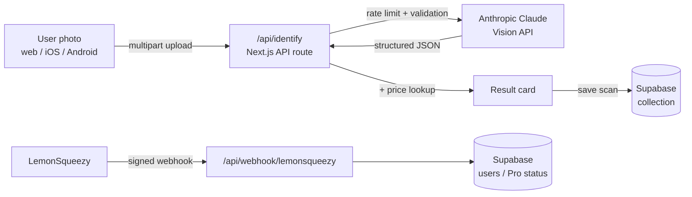

# WatchSnap

**AI-powered luxury watch identification and authentication.** Snap a photo of a watch and WatchSnap identifies the brand, model and reference number, flags signs of a replica, and estimates its secondary-market value.

**Live:** https://watchsnap.vercel.app

<!-- TODO: add a screenshot at docs/screenshot.png (e.g. the scan result screen), then uncomment the line below.

-->

## Features

- **Photo → identification** – take a photo with the camera or upload one; Claude Vision analyses bezel, dial, hands, crown, case and bracelet details.
- **Authenticity assessment** – *likely authentic / suspicious / cannot determine*, with a confidence score and a plain-language explanation. Low-quality photos are never labelled as replicas.
- **Alternative matches** – when a watch could be several references, the most likely models are listed with probabilities.
- **Market value estimate** – price range and demand trend from a built-in secondary-market price table.
- **Collection** – scans are saved locally and synced to the user's account in Supabase.
- **Freemium** – 3 free scans, then a Pro subscription (LemonSqueezy on web, StoreKit in-app purchase on iOS).
- **Installable everywhere** – PWA with offline page, plus native iOS and Android builds via Capacitor.

## Tech stack

| Area | Technology |
|---|---|
| Frontend | Next.js 14 (App Router), React, TypeScript, Tailwind CSS, Framer Motion |
| AI | Anthropic Claude Vision API |
| Backend | Next.js API routes on Vercel |
| Database & auth | Supabase (Postgres) |
| Payments | LemonSqueezy (web), StoreKit 2 via a custom Capacitor plugin (iOS) |
| Mobile | Capacitor 8 (iOS + Android) |
| CI/CD | Vercel (web), Codemagic (iOS App Store builds) |

## Architecture



1. The client sends the photo to `/api/identify` (max 10 MB, per-IP rate limiting, restricted CORS origins).
2. The API route calls Claude Vision with a structured inspection prompt and parses the JSON result.
3. The result is enriched with a market-value estimate and shown to the user.
4. The scan is stored in the user's collection in Supabase.
5. Subscription changes arrive via HMAC-verified LemonSqueezy webhooks and update the user's Pro status in Supabase.

The Anthropic key, Supabase service-role key and LemonSqueezy secrets are only read in server-side API routes – never shipped to the browser.

## Local setup

**Requirements:** Node.js 18+, an Anthropic API key, a Supabase project, and (for payments) a LemonSqueezy store.

```bash
git clone https://github.com/EyalTalias/watchsnap.git
cd watchsnap
npm install
cp .env.local.example .env.local   # then fill in your own values
npm run dev                        # http://localhost:3000
```

See [`.env.local.example`](.env.local.example) for every variable and [`SETUP.md`](SETUP.md) for Supabase and LemonSqueezy configuration.

### Native builds

```bash
npm run build:capacitor   # static export + cap sync android
npx cap open android      # or: npx cap sync ios && npx cap open ios
```

The native apps call the deployed API (`NEXT_PUBLIC_API_BASE_URL`), since API routes aren't part of the static export.
